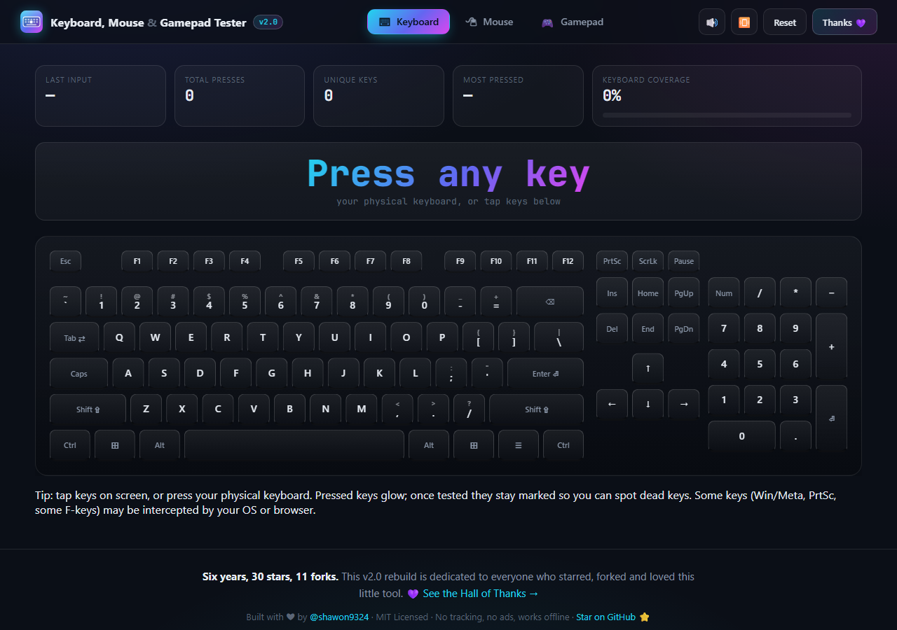
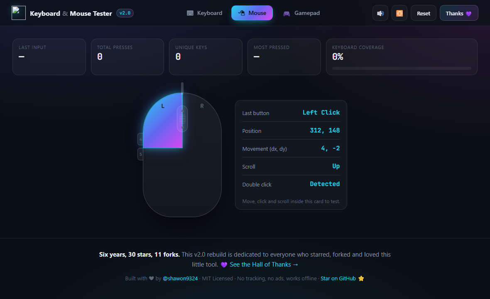
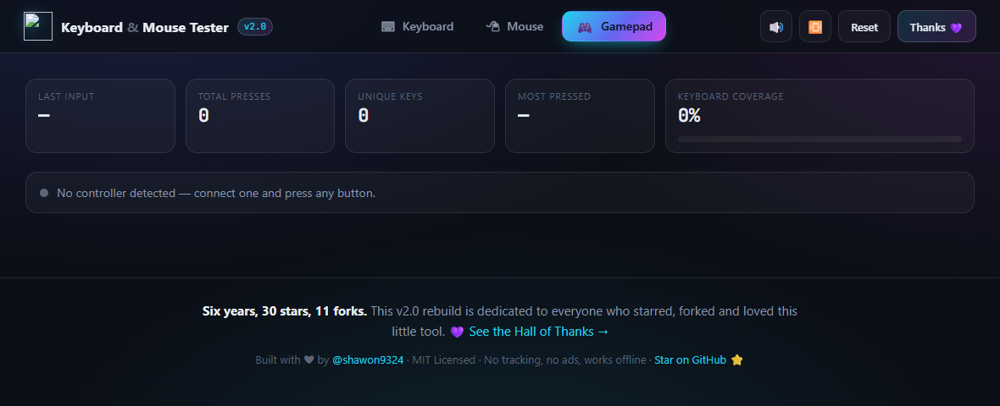
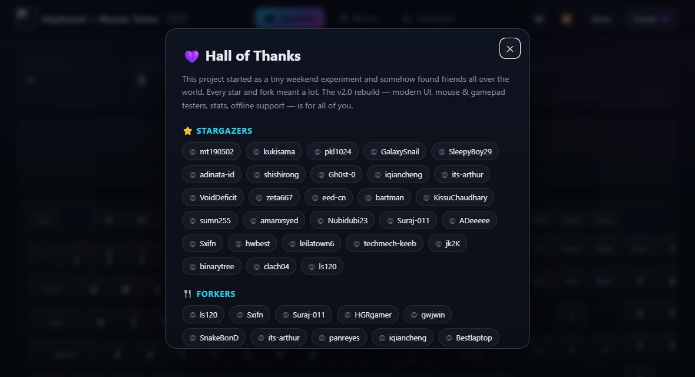
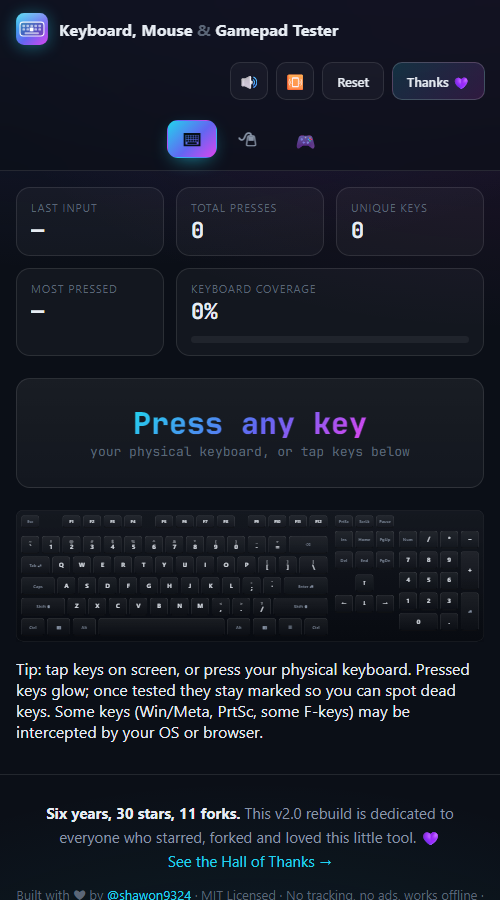

<div align="center">

# ⌨️ Keyboard, Mouse &amp; Gamepad Tester

### Test every key, mouse button, scroll wheel and gamepad — right in your browser.

[](https://keyboard-mouse-tester-web-app.vercel.app/)
&nbsp;
[](https://github.com/shawon9324/keyboard-mouse-tester-webApp/stargazers)
&nbsp;
[](https://github.com/shawon9324/keyboard-mouse-tester-webApp/network/members)
&nbsp;
[](LICENSE)

<br />



</div>

---

## 💜 A note for everyone who starred & forked this

This project started as a tiny weekend experiment six years ago, and somehow it found friends all
over the world — **30 stars and 11 forks**. That genuinely means a lot.

**v2.0** is a complete, ground-up rebuild dedicated to all of you: a modern UI, brand-new **mouse**
and **gamepad** testers, live **stats**, **sound + haptic** feedback, full **mobile/touch** support,
and **offline** capability — all with **zero external dependencies** and **no tracking, no ads**.
Scroll down to the [Hall of Thanks](#-hall-of-thanks) — your names are baked right into the app. 🙌

---

## ✨ Features

- ⌨️ **Full keyboard tester** — every standard key (~104), identified by the modern
  [`KeyboardEvent.code`](https://developer.mozilla.org/docs/Web/API/KeyboardEvent/code) API so
  left/right modifiers and the numpad are distinguished correctly.
- 💡 **Dead-key detection** — pressed keys glow; once tested they stay marked, so you can instantly
  spot keys that never registered.
- 🖱️ **Mouse tester** — left / middle / right + back/forward buttons, scroll up/down, live cursor
  position, movement deltas and double-click detection.
- 🎮 **Gamepad tester** — buttons, triggers and analog sticks via the
  [Gamepad API](https://developer.mozilla.org/docs/Web/API/Gamepad_API), with live values.
- 📊 **Live stats** — total presses, unique keys, most-pressed key, and a keyboard-coverage meter.
- 🔊 **Sound + 📳 haptics** — optional click feedback and vibration on mobile (toggleable, remembered).
- 📱 **Responsive & touch-friendly** — tap on-screen keys on phones and tablets; the layout scales fluidly.
- ⚡ **Zero dependencies, offline-ready** — no jQuery, no frameworks, no CDNs. Installable PWA with a
  service worker, so it works with no connection.
- 🔒 **Private by design** — everything runs locally in your browser. Nothing is sent anywhere.

## 🚀 Live demo

**→ https://keyboard-mouse-tester-web-app.vercel.app/**

> Tip: some keys (Win/Meta, PrtSc, certain F-keys) may be intercepted by your OS or browser before
> the page can see them — that's expected behavior, not a dead key.

## 📸 Screenshots

| Mouse tester | Gamepad tester |
| :---: | :---: |
|  |  |

| Hall of Thanks | Mobile |
| :---: | :---: |
|  |  |

## 🛠️ Tech

A deliberately simple, **zero-build static site** — easy to read, easy to fork, fast to load.

```
index.html              # markup + meta + PWA hooks
css/style.css           # modern responsive theme (CSS custom properties)
js/keymaps.js           # data-driven keyboard layout + key-name maps
js/app.js               # keyboard / mouse / gamepad / stats / feedback / PWA
sw.js                   # service worker (offline cache)
manifest.webmanifest    # PWA manifest
favicon.svg             # crisp vector icon
```

No package manager, no bundler, no transpiler — just open it.

## 💻 Run locally

Because there's no build step, you can simply open `index.html` in a browser.

For the PWA / service worker (and to avoid `file://` quirks), serve it over HTTP:

```bash
# Python 3
python -m http.server 8080

# …or Node
npx serve .
```

Then visit `http://localhost:8080`.

## ☁️ Deploy

The live site is hosted on **[Vercel](https://keyboard-mouse-tester-web-app.vercel.app/)** — it's a
zero-build static site, so every push auto-deploys with no configuration.

- **Vercel / Netlify / Cloudflare Pages:** import the repo, no build command, output directory `/` (root).
- **GitHub Pages:** **Settings → Pages → Deploy from a branch**, branch `main`, folder `/ (root)`.

Since there's no build step, it drops onto any static host exactly as-is.

## 💜 Hall of Thanks

This release is dedicated to the people who starred and forked this repo. Thank you — truly.

**⭐ Stargazers**

[@mt190502](https://github.com/mt190502) · [@kukisama](https://github.com/kukisama) · [@pkl1024](https://github.com/pkl1024) · [@GalaxySnail](https://github.com/GalaxySnail) · [@SleepyBoy29](https://github.com/SleepyBoy29) · [@adinata-id](https://github.com/adinata-id) · [@shishirong](https://github.com/shishirong) · [@Gh0st-0](https://github.com/Gh0st-0) · [@iqiancheng](https://github.com/iqiancheng) · [@its-arthur](https://github.com/its-arthur) · [@VoidDeficit](https://github.com/VoidDeficit) · [@zeta667](https://github.com/zeta667) · [@eed-cn](https://github.com/eed-cn) · [@bartman](https://github.com/bartman) · [@KissuChaudhary](https://github.com/KissuChaudhary) · [@sumn255](https://github.com/sumn255) · [@amanxsyed](https://github.com/amanxsyed) · [@Nubidubi23](https://github.com/Nubidubi23) · [@Suraj-011](https://github.com/Suraj-011) · [@ADeeeee](https://github.com/ADeeeee) · [@Sxifn](https://github.com/Sxifn) · [@hwbest](https://github.com/hwbest) · [@leilatown6](https://github.com/leilatown6) · [@techmech-keeb](https://github.com/techmech-keeb) · [@jk2K](https://github.com/jk2K) · [@binarytree](https://github.com/binarytree) · [@clach04](https://github.com/clach04) · [@ls120](https://github.com/ls120)

**🍴 Forkers**

[@ls120](https://github.com/ls120) · [@Sxifn](https://github.com/Sxifn) · [@Suraj-011](https://github.com/Suraj-011) · [@HGRgamer](https://github.com/HGRgamer) · [@gwjwin](https://github.com/gwjwin) · [@SnakeBonD](https://github.com/SnakeBonD) · [@its-arthur](https://github.com/its-arthur) · [@panreyes](https://github.com/panreyes) · [@iqiancheng](https://github.com/iqiancheng) · [@Bestlaptop](https://github.com/Bestlaptop) · [@pkl1024](https://github.com/pkl1024)

> Names captured at build time. If yours should be here and isn't, open an issue or PR and you're in!

## 🤝 Contributing

Issues and PRs are very welcome — bug reports, new keyboard layouts (ISO/JIS, other locales),
themes, accessibility improvements, translations. The codebase is small and dependency-free, so it's
a friendly place to make your first open-source contribution.

## 📜 License

[MIT](LICENSE) © [Md. Shahriar Karim Shawon (@shawon9324)](https://github.com/shawon9324)

<div align="center">

<br />

**If this tool helped you, a ⭐ means the world.**

</div>
